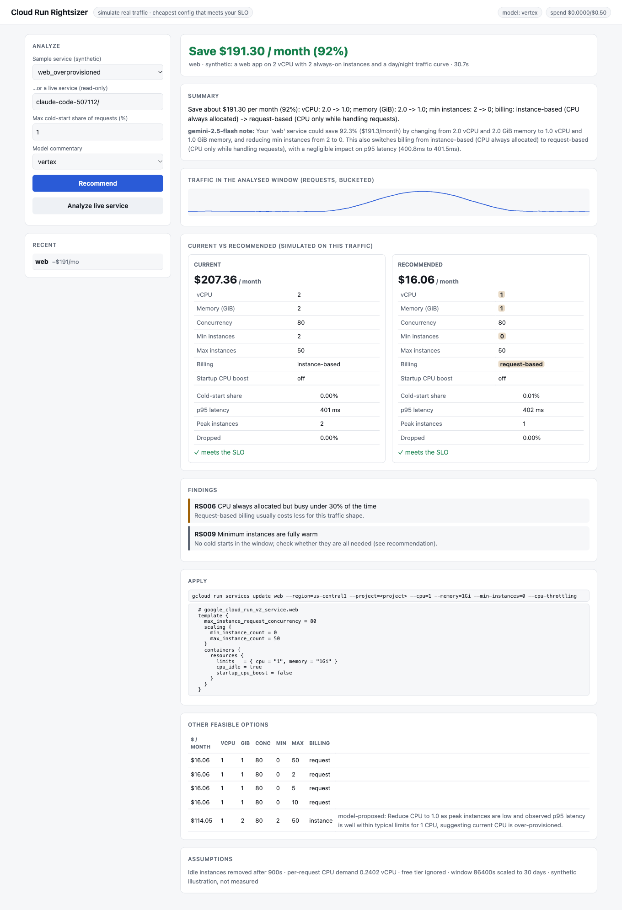

# gcp-cloudrun-rightsizer

Most Cloud Run services are sized by guess. This tool reads a service's real configuration and traffic (Cloud Run Admin API and Cloud Monitoring,
read-only), **replays the actual arrival pattern through a simulator** of Cloud Run autoscaling and billing, and recommends the cheapest
configuration that still meets an explicit SLO (cold-start share, p95 latency, dropped requests, memory headroom). Every recommendation comes with its
own predicted cold starts, latency and monthly cost, the `gcloud` command, and a Terraform snippet.



## How it works

```
live service (Admin API + Monitoring) or snapshot.json
   -> simulator: request-level replay of the real traffic
        packed routing, ~60% concurrency scale-out in the background, sampled startup times, 15 min idle timeout,
        CPU contention, request-based vs instance-based billing (prices from the Cloud Billing Catalog API)
   -> search: billing mode, concurrency, CPU/memory, min/max instances, startup boost; each candidate simulated
   -> cheapest candidate that meets the SLO; changes under max($1, 3%) are not worth making and are not recommended
   -> optional model: explains the result (numbers validated) and proposes one alternative (simulated before it is listed)
```

The simulator decides; models only phrase and propose. The numbers a model may quote must appear in the analysis, links are rejected, and a proposed
configuration is checked as a legal Cloud Run configuration, simulated, and listed only if it meets the SLO and is cheaper.

## Quick start

```bash
python3 -m venv .venv && .venv/bin/pip install -e ".[dev]"
.venv/bin/rightsize recommend rightsize/samples/web_overprovisioned.json --llm none; echo "exit=$?"   # 1 = a cheaper config exists

# a real service in your project (read-only; needs run.viewer and monitoring.viewer)
.venv/bin/rightsize collect my-project my-service --hours 48 > snap.json
.venv/bin/rightsize recommend snap.json --max-cold-start 0.005 --p95-ms 400 --llm vertex
```

Exit codes: 0 already optimal, 1 a cheaper config exists, 2 the current config misses the SLO, 3 error.

## Deploy to GCP

```bash
cp deploy.env.example deploy.env && ./scripts/up.sh
gcloud run services proxy rightsizer --region us-central1 --port 8081
./scripts/down.sh
```

Terraform creates APIs, Artifact Registry, a build identity, a runtime service account (`aiplatform.user`, `logging.logWriter`, and read-only
`run.viewer` + `monitoring.viewer`), the private `rightsizer` service (2 vCPU / 2 GiB for parallel simulation, one instance, one invoker, no `allUsers`)
and `rs-target`, a small test service used by the validation experiment. Live mode only analyses projects in `RIGHTSIZE_LIVE_PROJECTS`.

Docs: [architecture](docs/architecture.md) · [threat model](docs/threat-model.md) · [runbooks](docs/runbooks/) · [ADRs](docs/adr/) ·
[**validation against a real service**](docs/validation-results.md) · [model eval](docs/eval-results.md)

## Does the simulator match reality? (docs/validation-results.md)

I drove a real Cloud Run service (`rs-target`: 1 vCPU, 512 MiB, concurrency 4, request-based) with three scripted burst patterns from a cold start and
compared Cloud Monitoring's measurements with the simulator's prediction for the same schedule.

| | A (used to build the model) | B (also seen) | **C (run after the model was frozen)** |
|---|---|---|---|
| Instances started (measured / predicted) | 11 / 10 | 10 / 9 | **5 / 5** |
| Billable instance-seconds | 149 / 172 | 79 / 69 | **326 / 324** |
| Warm (server-side) p50 latency | 394 / 414 ms | 251 / 263 ms | **842 / 813 ms** |
| Client p95 latency | 2283 / 474 ms | 540 / 293 ms | **981 / 890 ms** |
| Client p99 latency | 15686 / 14710 ms | 2790 / 1407 ms | **1242 / 945 ms** |

What the validation found and fixed: the first version under-predicted scale-out by half (Cloud Run starts instances in the background at about 60%
concurrency utilisation, not only when every instance is full) and treated startup as a constant, when it was 1 s on a warm host and 14 s on a cold one;
it also spread requests across instances, which overstates request-based billing. Pattern C was run after those fixes, so it is the one honest
out-of-sample check. **Counts, billable time and warm latency are within about 15%; tail latency is under-predicted in bursty patterns** (p95 by 9-79%,
p99 by 6-50%), so treat predicted p95/p99 as optimistic.

Other checks: 44 offline tests (simulator mechanics, billing, search, SLOs, model-output validation, collector, API, CLI, parallel = sequential);
model eval across mock, gemini-2.5-flash and gpt-5-nano with **0 cases where a model changed the recommendation** (5 samples x 3 providers); a live analysis
of `rs-target` from its real Cloud Monitoring data on the deployed service returned "already optimal" for a $4/month service.

## Limits

- **Tail latency is under-predicted** (see above) and cold starts from sub-minute bursts are invisible in per-minute metrics, so cold-start shares
  from live analysis are understated. Use a stricter SLO or keep a min instance for bursty services.
- Validated on one synthetic workload type (a service that waits, so CPU is idle) in one region with three patterns. The **CPU-contention model,
  memory scaling and the 15-minute idle timeout are not validated**, and the idle timeout is an observed tendency (instances persisted ~15 minutes),
  not a guarantee.
- The bundled samples are synthetic illustrations, not measurements; their savings are what the model computes for invented traffic.
- Prices are us-central1 from the Cloud Billing Catalog API (regenerate with `scripts/fetch_pricing.py`); the free tier, committed use, networking and
  other regions are not modelled.
- The search is a heuristic (coordinate descent), not a global optimum. Windows are limited to 400k requests; the largest sample takes about 90 s on the
  deployed service.
- Hourly percentiles from Cloud Monitoring are averaged over the window, which is an approximation (it can make p99 < p95).
- It recommends and prints commands; it never changes your services.
